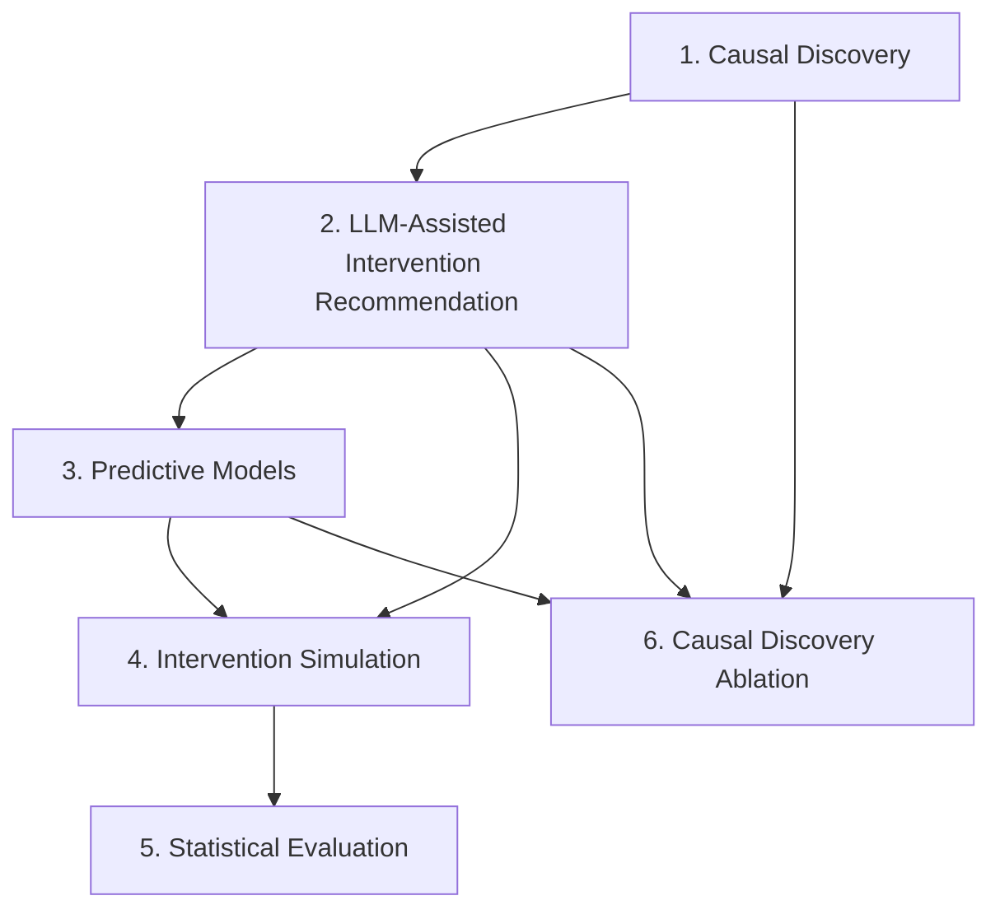

# Causal Discovery and LLM-Assisted Customer Churn Interventions

**Research repository:** [causal-interventions/Framework](https://github.com/causal-interventions/Framework)

## Overview

This repository contains the research code, datasets, learned causal structures, intervention recommendations, predictive models, experimental results, and statistical analyses associated with the proposed causal-prescriptive framework for customer churn management.

The framework integrates causal discovery, cross-algorithm causal evidence aggregation, path-based structural importance and directional analysis, large language model (LLM)-assisted intervention recommendation, and multi-model predictive evaluation.

The experiments use the Telco Customer Churn dataset and investigate how structurally informed customer retention interventions can be identified, prioritized, and evaluated through simulated modifications of customer profiles.

## Repository Structure

```text
Framework/
├── 1. Causal Discovery/
│   ├── code/
│   ├── DAGs/
│   ├── dataset/
│   ├── models/
│   └── results/
├── 2. LLMs/
│   ├── code/
│   ├── inputs/
│   └── results/
├── 3. Predictive Models/
│   ├── code/
│   ├── frozen_models/
│   └── inputs/
├── 4. Intervention Simulation/
│   ├── code/
│   ├── inputs/
│   └── results/
├── 5. Statistical Evaluation/
│   ├── code/
│   ├── inputs/
│   └── results/
│       └── Telco_Ranking_Comparison_Figures/
├── 6. Causal Discovery Ablation/
│   ├── code/
│   ├── inputs/
│   └── results/
│       └── Ablation_Figures/
└── README.md
```

## 1. Causal Discovery

[Browse this directory](1.%20Causal%20Discovery/)

This stage identifies candidate causal relationships between customer attributes and churn using three complementary causal discovery algorithms: NOTEARS, GOLEM, and DAGMA.

### Notebooks

- `churn_NOTEARS.ipynb`
- `churn_GOLEM.ipynb`
- `churn_DAGMAs.ipynb`

### Research artifacts

- `dataset/`: original Telco Customer Churn dataset and one-hot-encoded, Min–Max-normalized dataset.
- `models/`: serialized causal discovery models (`.pkl`).
- `DAGs/`: interactive HTML visualizations of the filtered directed acyclic graphs (DAGs).
- `results/`: algorithm-specific and aggregated structural importance rankings.

Two intervention prioritization approaches are considered:

1. **Global Score (GS):** aggregates normalized rankings based on direct relationships with Churn across the three causal discovery algorithms.
2. **Path-Based Structural Importance (PS):** incorporates direct relationships and two-step directed paths, with a separate directional analysis. Three path-weighting configurations are considered: λ = 0.25, 0.50, and 0.75.

The consolidated workbook `Global Score - Path Based Structural Importance - Final Ranks.xlsx` brings together the resulting importance scores and rankings.

## 2. LLM-Assisted Intervention Recommendation

[Browse this directory](2.%20LLMs/)

This stage translates structural and directional evidence into candidate customer retention interventions using LLM-assisted reasoning.

The notebooks assess potential actionability, propose target values, and generate intervention recommendations and corresponding rationales. Structural scores and rankings are computed independently of the LLM. Recommendations used in downstream experiments incorporate human review.

### Notebooks

- `LLM_Assisted_Intervention_Identification_GPT6_1_Sol.ipynb`
- `LLM_Assisted_Intervention_Identification_GPT6_Astra.ipynb`

The notebooks contain the intervention formulation prompt and API-based generation procedures. Their configured model identifiers are `gpt-6.1-sol` and `gpt-6-astra`, respectively.

- `inputs/`: original and transformed datasets, Global Score input workbook, and Path-Based Structural Importance input workbook for λ = 0.75.
- `results/`: completed recommendation workbooks for both ranking approaches and both LLM configurations.

The API-based notebooks require an OpenAI API key and access to the configured models. The notebooks transmit schema information and causal feature/sign pairs rather than individual customer records. Existing output workbooks are provided to support inspection without repeating the API calls.

## 3. Predictive Models

[Browse this directory](3.%20Predictive%20Models/)

This stage trains, optimizes, and evaluates four customer churn prediction models:

- XGBoost
- Random Forest
- Gradient Boosting Machine (GBM)
- CatBoost

### Notebook

`Telco_Predictive_Models_Optuna.ipynb`

The experimental procedure uses a fixed stratified 70/15/15 training, validation, and test split, Optuna hyperparameter optimization with five-fold cross-validation based on ROC AUC, and model-specific classification thresholds selected on the validation subset.

The notebook also contains baseline predictive evaluation and an initial intervention evaluation procedure.

The final models and classification thresholds are frozen before the comparative intervention experiments.

- `inputs/`: original dataset and recommended actions workbook.
- `frozen_models/`: four serialized predictive models (`.joblib`) and `experiment_metadata.json`, containing the information required to recreate the experimental configuration.

## 4. Intervention Simulation

[Browse this directory](4.%20Intervention%20Simulation/)

### Notebook

`Intervention_Simulation.ipynb`

This stage compares four intervention prioritization strategies under a fixed predictive evaluation environment:

- Global Score (GS);
- Path-Based Structural Importance, λ = 0.25;
- Path-Based Structural Importance, λ = 0.50;
- Path-Based Structural Importance, λ = 0.75.

Candidate interventions are classified into HIGH, MEDIUM, and LOW priority levels using percentile-based thresholds. Three cumulative intervention scenarios are evaluated:

| Scenario | Included priority levels |
| --- | --- |
| H | HIGH |
| H+M | HIGH and MEDIUM |
| H+M+L | HIGH, MEDIUM, and LOW |

Interventions are simulated by modifying eligible customer attributes in the original test data and evaluating the modified profiles using the same frozen predictive models and classification thresholds.

Three baseline evaluation cohorts are retained:

- **TP:** observed churners correctly classified as churners.
- **FP:** observed non-churners incorrectly classified as churners.
- **TP+FP:** the complete baseline predicted-positive cohort.

The principal probability-based outcome is the predicted churn probability reduction:

$$\Delta P = P_{\mathrm{before}} - P_{\mathrm{after}}.$$

Positive values indicate a reduction in predicted churn risk. For baseline true positives, a predicted class transition from Yes to No is counted as a model-predicted rescue. For false positives and the combined cohort, threshold-crossing outcomes are distinguished from true-positive rescues.

The notebook also includes baseline probability calibration diagnostics, classification-threshold sensitivity analysis, strategy overlap, and action-application diagnostics.

### Main output

`results/Telco_GlobalScore_vs_PathStructural_Intervention_Results.xlsx`

This workbook contains intervention evaluation results, including customer-level outcomes used by the subsequent statistical evaluation stage.

## 5. Statistical Evaluation

[Browse this directory](5.%20Statistical%20Evaluation/)

### Notebook

`Statistical Evaluation.ipynb`

This stage provides descriptive and inferential analyses of the comparative intervention results, including:

- Descriptive statistics of predicted churn probability reductions.
- Effectiveness rates and classification threshold-crossing outcomes.
- Bootstrap 95% confidence intervals using 10,000 resamples.
- Paired Wilcoxon signed-rank tests for probability reductions.
- Exact McNemar tests for paired classification threshold-crossing outcomes.
- Friedman tests and post-hoc paired comparisons for sensitivity to λ.
- Multiple-comparison adjustments and effect-size analysis.
- Cross-model robustness analysis of Global Score versus Path-Based Structural Importance (λ = 0.75).

### Main outputs

- `results/Telco_GlobalScore_vs_PathStructural_Statistical_Evaluation.xlsx`
- `results/Telco_Ranking_Comparison_Figures/`

The figures include comparisons of prioritization strategies, probability-reduction distributions, model-predicted rescue rates, λ sensitivity, cross-model robustness, and baseline calibration diagnostics. Most comparative figures are supplied at 600 dpi.

## 6. Causal Discovery Ablation

[Browse this directory](6.%20Causal%20Discovery%20Ablation/)

### Notebook

`PathStructural_Ablation_Lambda075.ipynb`

This stage examines the contribution of individual causal discovery algorithms to the proposed path-based intervention prioritization approach with λ = 0.75.

Four configurations are evaluated:

| Configuration | Included algorithms |
| --- | --- |
| Full | NOTEARS, GOLEM, DAGMA |
| No_NOTEARS | GOLEM, DAGMA |
| No_GOLEM | NOTEARS, DAGMA |
| No_DAGMA | NOTEARS, GOLEM |

The analysis compares recommendation overlap, ranking agreement, predicted churn probability reductions, rescue rates, and the number of applied actions under alternative intervention-selection budgets. The same frozen predictive models, thresholds, test split, and baseline cohorts are retained.

### Main outputs

- `results/PathStructural_Ablation_Lambda075_Results.xlsx`
- `results/Ablation_Figures/`: publication-quality ablation figures (600 dpi).

## Dataset

The experiments are based on the publicly available IBM Telco Customer Churn dataset. The repository includes the original dataset (`Telco-Customer-Churn.xlsx`) and a preprocessed representation (`Telco-Churn-OneHot-MinMax.xlsx`) used for causal discovery.

Dataset copies are also included in the relevant stage-specific input directories to facilitate independent inspection of the experimental stages.

## Software Environment

The experiments are implemented in Python using Jupyter notebooks. The principal dependencies include:

| Purpose | Libraries |
| --- | --- |
| Data processing | NumPy, pandas, openpyxl |
| Causal discovery | CausalNex, DAGMA, gCastle, NetworkX, LiNGAM (imported by the GOLEM notebook) |
| LLM integration | OpenAI Python SDK |
| Predictive modeling | scikit-learn, XGBoost, CatBoost, Optuna, joblib |
| Statistical analysis | SciPy |
| Visualization and notebook utilities | Matplotlib, seaborn, SHAP, IPython, ipynbname |

Compatible library versions should be selected for the relevant notebooks, particularly when loading serialized models. A fully pinned dependency manifest is not included in the current repository.

## Reproducing and Inspecting the Experiments

### Getting started

Clone the repository and open it in JupyterLab or Jupyter Notebook:

```bash
git clone https://github.com/causal-interventions/Framework.git
cd Framework
jupyter lab
```

Install Jupyter and the required dependencies in a compatible Python environment before running the notebooks.

### Experimental workflow

The six numbered directories reflect the logical experimental workflow:



1. Inspect or execute the causal discovery notebooks and review the saved structural rankings.
2. Inspect the supplied LLM-generated recommendations or execute the API notebooks to generate new recommendations.
3. Train and optimize the predictive models, or reuse the supplied frozen models and experiment metadata.
4. Execute the intervention simulation notebook using the recommended actions and frozen models.
5. Execute the statistical evaluation notebook using the customer-level intervention results.
6. Execute the ablation notebook using the supplied ablation rankings and frozen models.

**Execution notes:**

- The repository is organized as a collection of research notebooks and preserved experimental artifacts, rather than an automated end-to-end pipeline. Some aggregated rankings and reviewed intervention workbooks are supplied as intermediate artifacts.
- Before executing a notebook, check its file-path configuration. Some notebooks expect input files and model directories in the current working directory rather than in the adjacent `inputs/` or `dataset/` directories. Adjust paths or arrange local working copies accordingly.
- To reproduce the comparative predictive evaluation without retraining, use the supplied frozen models, metadata, and recommended-action workbooks.
- To reproduce the statistical analysis without rerunning intervention simulations, use the supplied intervention results workbook in `5. Statistical Evaluation/inputs/`.
- New LLM API calls may generate different recommendations and depend on model availability. Do not commit API keys to the repository.

## Interpretation of Results

The learned causal structures provide candidate causal evidence for intervention identification and prioritization. The experimental evaluation measures changes in model-predicted churn probabilities and predicted classifications under simulated customer-profile modifications.

These outcomes should not be interpreted as experimentally verified causal treatment effects or observed customer retention outcomes. Real-world effectiveness would require additional causal identification assumptions and empirical intervention validation.

## Citation

This repository accompanies a research manuscript describing the proposed causal-prescriptive customer churn intervention framework. The complete bibliographic citation and DOI will be added when available. Until then, the research artifacts can be referenced using the repository URL: https://github.com/causal-interventions/Framework.

## License

A repository license has not yet been specified. The original dataset and third-party software remain subject to their respective terms and licenses.
